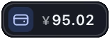
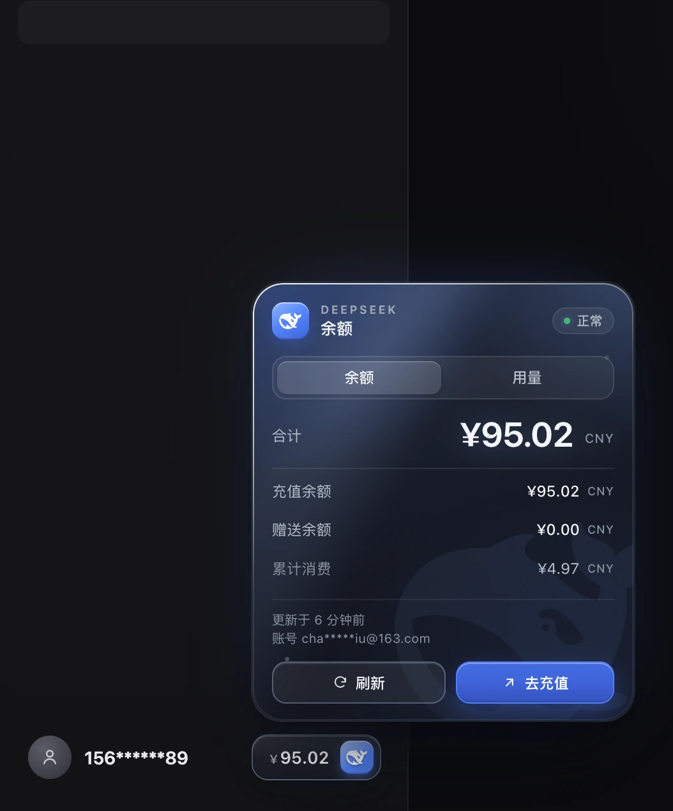
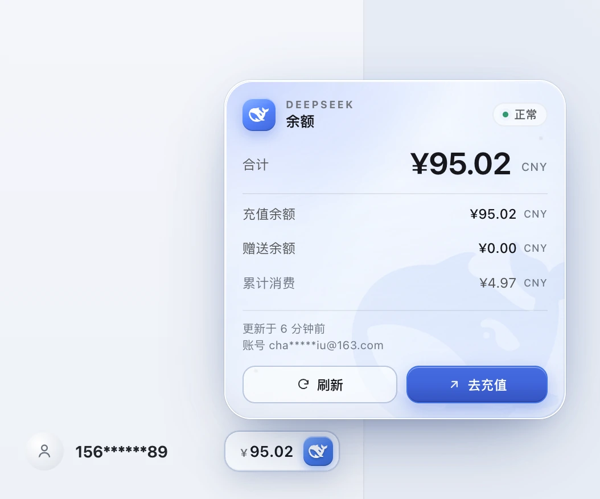
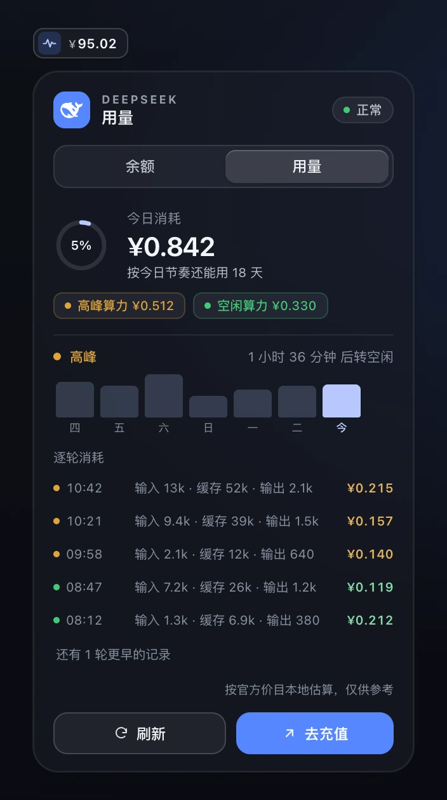
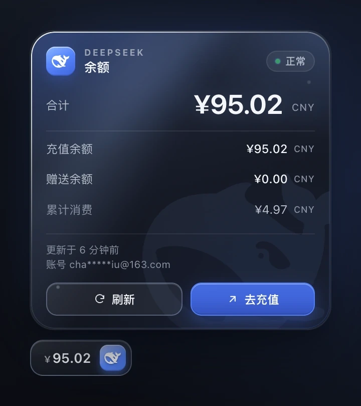
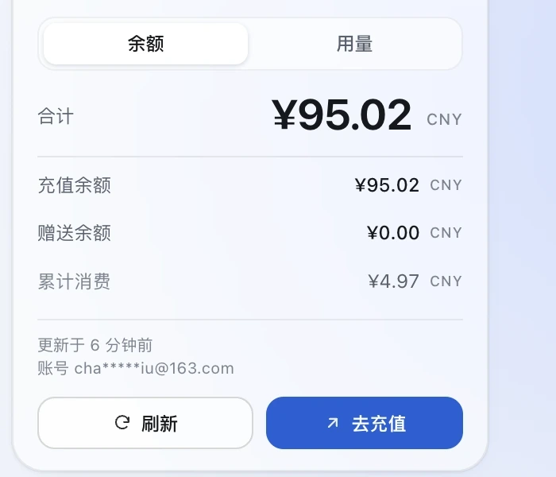
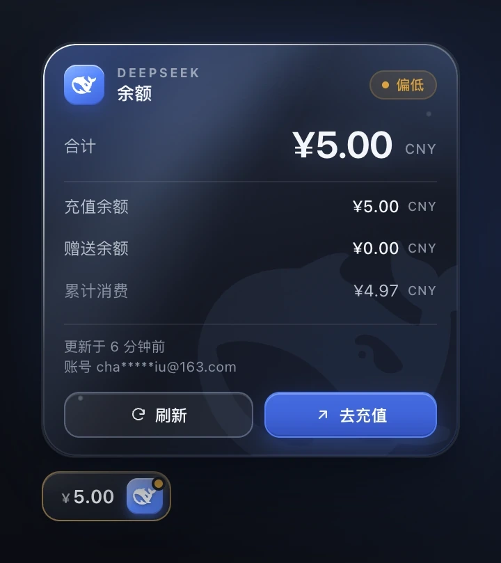
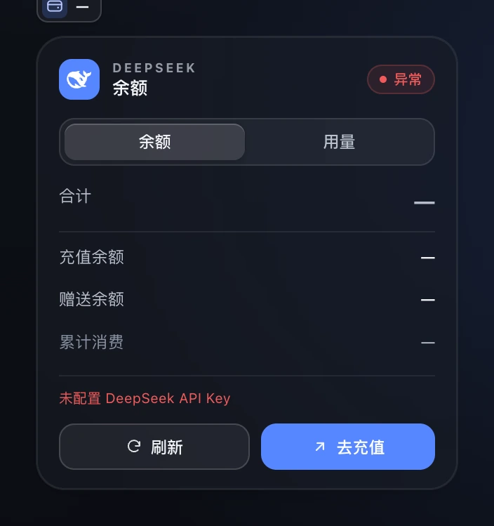
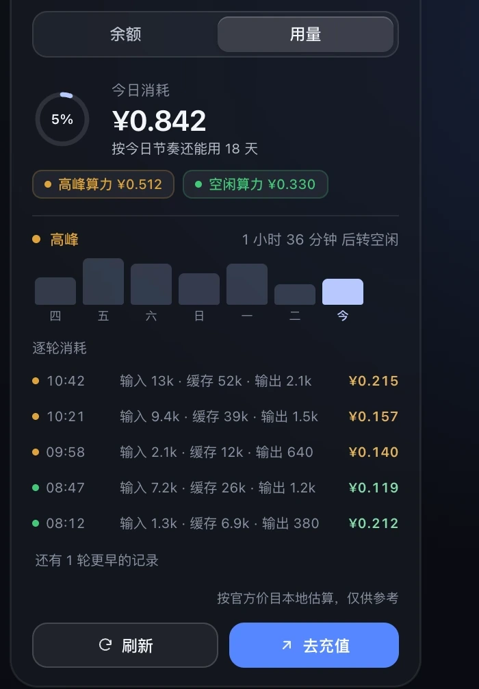
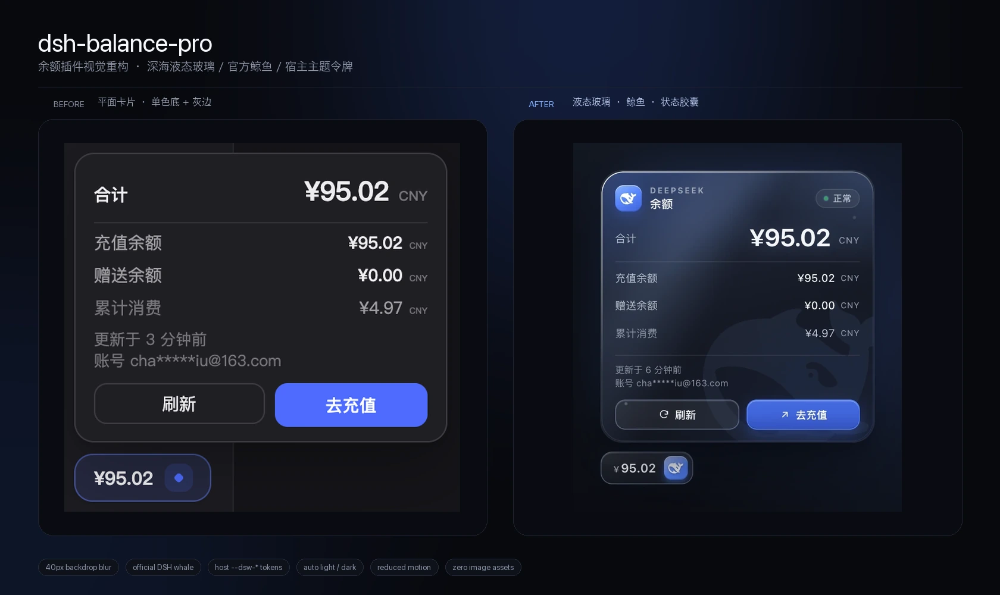

<div align="center">



<br />

<h1>dsh-balance-pro</h1>

<p><strong>DeepSeek Harness 插件 · 侧边栏余额徽章</strong><br />
只读 · API Key 不出宿主进程 · 深海液态玻璃</p>

<p>
  
  
  
  
</p>

<p>
  <a href="#安装">安装</a> ·
  <a href="#配置">配置</a> ·
  <a href="#界面">界面</a> ·
  <a href="docs/visual.md">视觉设计</a> ·
  <a href="#界面">界面</a> · <a href="#常见问题">常见问题</a>
</p>

</div>

---

在 [DeepSeek Harness](https://github.com/deepseek-ai/deepseek-harness) 里显示 DeepSeek 账户余额：**侧边栏账号行右端一个 `余额 ¥94.96` 徽章**，点开是一张明细卡片——合计、充值余额、赠送余额、累计消费、更新时间和账号，带「刷新」和「去充值」。

不需要填 Key：配了 API Key 或登录过客户端，二者有一个就能读。

余额与用量分成两个标签页：默认停在**余额**，切到**用量**看今日消耗、峰谷价与逐轮消耗。

<table>
  <tr>
    <td width="50%"></td>
    <td width="50%"></td>
  </tr>
  <tr>
    <td align="center"><sub><b>余额</b> · 深色 · 跟随宿主主题</sub></td>
    <td align="center"><sub><b>余额</b> · 浅色 · 同一套令牌</sub></td>
  </tr>
</table>



## 为什么值得装

- **只读**：不写会话、不改模型配置；点「去充值」才会打开 DeepSeek 充值页。
- **Key 不出宿主进程**：浏览器半区只拿到金额和平台掩码后的账号，拿不到 key、请求头或上游原文。
- **失败不拖垮页面**：没配 key、key 失效、断网时徽章显示 `余额 —`，卡片里写明原因；不会让 DSH 启动失败。
- **扁平半透明玻璃**：两种外观都是纯半透明底 + 1px 发丝边 + 短阴影，没有渐变高光、镜面描边、噪点或装饰水印；靠背景模糊（20–28px）保留玻璃感。
- **跟随系统外观**：以 macOS 的浅色/深色为准，切换即时生效；浅色是白底半透明，深色是深灰半透明，同一套结构。
- **用量标签页**：今日消耗、峰谷价与逐轮消耗，按官方价目本地估算，进度环只在「余额 ÷ 今日节奏」真实存在时才出现。
- **离线自足**：鲸鱼与背景都是内联 SVG / CSS，无图片请求、无第三方依赖、无遥测。

---

## 目录

- [界面](#界面)
- [视觉设计](docs/visual.md)
- [安装](#安装)
- [卸载](#卸载)
- [更新](#更新)
- [配置](#配置)
- [余额从哪来](#余额从哪来)
- [数据契约](#数据契约)
- [发布到 npm（可选）](#发布到-npm可选)
- [常见问题](#常见问题)
- [已知限制](#已知限制)
- [开发](#开发)
- [License](#license)

---

## 界面

### 正常的余额

| 深色（系统深色） | 浅色（系统浅色） |
|---|---|
|  |  |

徽章是「钱包图标 + 金额」，24px 高、与左侧头像文字齐平；切到用量标签时图标换成趋势线。金额超过一百万时缩写为 `¥9.99m`，悬停提示和卡片里始终是精确值。

卡片分四块：品牌头（鲸鱼徽标 + `DEEPSEEK / 余额` + 状态胶囊）、**余额 / 用量标签条**、明细（27px 合计 + 三行次级信息 + 更新时间/账号）、操作（刷新 / 去充值）。右下角是鲸鱼剪影，只做背景，不抢数字。

两种外观共用同一套扁平结构，只有色值不同：深色是 `rgba(24,27,36,.62)`，浅色是 `rgba(255,255,255,.58)`，各自配 1px 发丝边和一层很短的阴影。外观由 **macOS 系统设置**决定，切换后无需刷新。

### 状态一眼可读

状态胶囊永远带文字，不只靠颜色：

| 胶囊 | 触发条件 | 徽章 |
|---|---|---|
| **正常** | 读到可用余额 | 品牌蓝边框 |
| **偏低** | 低于 `lowBalanceThreshold` | 琥珀色边框 + 右上角红点 |
| **缓存** | 本次刷新失败，显示上次成功值 | 琥珀色 + 卡片内说明原因 |
| **异常** | 没配 key / key 失效 / 网络不可达 | 红色 + 可读原因 |
| **读取中** | 首次读取或手动刷新 | 鲸鱼徽标呼吸 |

<table>
  <tr>
    <td width="50%"></td>
    <td width="50%"></td>
  </tr>
  <tr>
    <td align="center"><sub>偏低 · 琥珀色 + 肩部红点</sub></td>
    <td align="center"><sub>未配置 · 写明原因而不是错误码</sub></td>
  </tr>
</table>

### 用量标签页



| 区块 | 说明 |
|---|---|
| **今日消耗** | 今天所有已结算轮次的费用之和；下面的环形进度是「余额 ÷ 今日折算全天消耗」，也就是按今天的节奏还能用几天 |
| **高峰 / 空闲算力** | 今天分别落在高峰、空闲时段的费用，一眼看出错峰省了多少 |
| **峰谷状态** | 现在处于高峰还是空闲（北京时间工作日 09:00–12:00、14:00–18:00 为高峰），以及多久后切换 |
| **近 7 天** | 每天消耗的柱状图，今天高亮 |
| **逐轮消耗** | 今天最近 5 轮：时间、输入/缓存/输出 token、费用；橙点时高峰、绿点时空闲 |

数据来自宿主收到的会话用量事件，按 `cordis.patch.yml` 里的价目表在本地折算，**不上传任何内容**，也不记录提示词。模型不在价目表里时只计 token、不计金额。

### 重构前后



材质、层级与鲸鱼的取舍写在 [视觉设计说明](docs/visual.md)。

---

## 安装

### 前置条件

- 已安装 **DeepSeek Harness 桌面端**（本插件在 `0.2.2-rc.1` 实测可用）。
- 一个 DeepSeek 账户：**配了 API Key** 或 **在客户端里登录过** 都可以，二者有一个即可。

### 第一步：确认 `dsh` 命令可用

桌面端自带 CLI。先试：

```sh
dsh --version
```

没有这个命令也没关系，用应用包内的绝对路径代替（macOS）：

```sh
DSH="/Applications/DeepSeek Harness.app/Contents/Resources/runtime/cli/bin/dsh"
"$DSH" --version
```

> 下文所有 `dsh` 都可以替换成上面的 `"$DSH"`。
> Windows 用户请把路径换成对应的安装目录，或直接使用应用自带终端。

### 第二步：安装插件

**方式 A：从 GitHub 安装（推荐）**

```sh
dsh plugin --profile desktop add "github:chauvetliu/dsh-balance-pro"
```

**方式 B：从本地目录安装（开发/离线）**

```sh
dsh plugin --profile desktop add "link:/绝对路径/dsh-balance"
```

安装命令会把包装进当前 profile 的 `node_modules`，并**自动**把 `dsh-balance` 写进 profile 的 bundle 列表。装完的 `~/.dsh/profiles/desktop/package.json` 大致是这样：

```jsonc
{
  "dependencies": {
    "dsh-balance-pro": "github:chauvetliu/dsh-balance-pro"
  },
  "dsh": {
    "profile": {
      "bundles": ["@deepseek-ai/dsh-base", "@deepseek-ai/dsh-web-app", "dsh-balance-pro"]
    }
  }
}
```

### 第三步：重启应用

**宿主半区（`index.js`、`lib/*`）只在启动时加载**，所以装完必须重启一次 DeepSeek Harness（点窗口里的「重启」，或完全退出再打开）。

### 第四步：确认生效

打开任意对话，看侧边栏底部账号行（头像 + 打码手机号）的**右端**是否出现 `¥xx.xx` 徽章：

- 有金额 → 成功；
- 显示 `余额 —` → 插件已生效但没读到余额，点开卡片看原因（见[常见问题](#常见问题)）；
- 什么都没有 → 看下面的排查。

在页面控制台（⌥⌘I）执行：

```js
window.__dshBalanceProStatus
// { mounted: true, ..., lastUrl: "/dsh-balance-pro/balance.json", lastError: "", lastOrigin: "relative" }
```

`undefined` 说明模块根本没加载（多半是没重启，或包没进 bundle 列表）。

---

## 卸载

```sh
dsh plugin --profile desktop remove dsh-balance
```

这条命令会从 `dependencies` 和 `dsh.profile.bundles` 里删掉该包，然后**重启应用**即可。徽章、样式和它注册的路由都会随插件卸载一起消失，不会残留。

如果命令不可用，也可以手动编辑 `~/.dsh/profiles/desktop/package.json`：

1. 删掉 `dependencies` 里的 `"dsh-balance-pro"` 一行；
2. 删掉 `dsh.profile.bundles` 数组里的 `"dsh-balance-pro"`；
3. 重启应用。

> 卸载不会动你的 API Key、账号登录态或任何会话数据——插件从不写这些。

---

## 更新

```sh
# 从 GitHub 安装的
dsh plugin --profile desktop add "github:chauvetliu/dsh-balance-pro"
# 本地 link 安装的：git pull / 改完代码即可
```

更新后**重启应用**。只有 `client.js` 变了的话，**刷新页面（⌘R）**就够了——前端 bundle 是宿主每次请求从磁盘读取的。

---

## 配置

在 `~/.dsh/profiles/desktop/cordis.patch.yml` 里按 id 覆盖（用户 patch 层在 bundle 层之后，优先级更高）：

```yaml
- id: dsh-balance
  name: dsh-balance-pro
  config:
    refreshMinutes: 5         # 后台刷新间隔（分钟）
    lowBalanceThreshold: 20   # 低于 20 元时显示警示色
    currency: CNY             # 多币种账户时优先取哪个
```

| 字段 | 默认 | 说明 |
|---|---|---|
| `apiKeyEnv` | `DEEPSEEK_API_KEY` | 读哪个凭据引用名 |
| `baseURL` | `https://api.deepseek.com` | 余额接口前缀，走代理/自建网关时改这里 |
| `currency` | `CNY` | 多币种钱包优先选哪个币种（不做汇率换算） |
| `refreshMinutes` | `10` | 宿主后台刷新间隔（上限 24 小时），前端轮询读同一个值 |
| `lowBalanceThreshold` | `10` | 低于该金额时徽章变警示色并显示红点 |
| `readTotalCosts` | `true` | 是否读取「累计消费」和账号邮箱（见下） |
| `requestTimeoutMs` | `8000` | 单次上游请求超时（上限 60 秒） |
| `pricing` | 官方价目 | 用量标签页的价目表与峰谷时段，单位「元 / 百万 tokens」 |
| `usageDays` | `7` | 近 N 天柱状图（上限 90） |
| `usageTurnLimit` | `40` | 逐轮列表最多返回多少轮（上限 200） |
| `usageStorePath` | `$DSH_HOME/balance-pro-usage.jsonl` | 用量账本文件；目录不可写时只保留内存计数 |

### `readTotalCosts` 是什么

DeepSeek 官方 SDK 的 `deepseekAccount` 服务只投影出两个钱包，**丢掉了 `total_costs`（累计消费）**。为了显示这一行，插件会在开启时用**同一份账号凭据**再读一次平台 summary/profile。

- `true`（默认）：卡片显示累计消费和邮箱；
- `false`：完全不碰官方服务之外的接口，累计消费显示 `—`，账号退化为手机号掩码。

### `pricing` 是什么

用量标签页的费用是**本地估算**：平台接口只给钱包余额和累计消费，没有按日、按轮的金额，但每一轮结算都带提供方的 token 用量。插件把用量按价目表折算，价目默认是官方公开价：

```yaml
pricing:
  offPeakMultiplier: 0.5           # 空闲价 = 高峰价 × 0.5
  peakWindows: ['09:00-12:00', '14:00-18:00']   # 北京时间
  peakWeekdaysOnly: true           # 周末全天空闲
  models:                          # 元 / 百万 tokens
    deepseek-flash:  { cacheHit: 0.04, cacheMiss: 2, output: 8 }
    deepseek-v4-pro: { cacheHit: 0.30, cacheMiss: 9, output: 27 }
```

输入按「缓存命中 / 未命中」两段计价，缓存写入按未命中价；输出单独计价。价目变了改这里即可，不需要改代码。模型不在 `models` 或 `aliases` 里时只计 token、不计金额（显示 `—`），不会瞎猜。

---

## 余额从哪来

页面**只发相对路径** `fetch('/dsh-balance-pro/balance.json')`——桌面壳会把它转发给宿主并带上浏览器 cookie，这是宿主信任栅栏唯一必过的路径。

宿主端两条取数路径，**API Key 优先**：

1. **API Key 路**：`ctx.credentials.resolve('DEEPSEEK_API_KEY')` → `GET https://api.deepseek.com/user/balance`；
2. **账号登录路**：没有 key（或 key 失效）时，用 DSH 账号会话 `deepseekAccount.getBalance(...)`。平台把钱包拆成 `value`（充值）和 `bonusWallets`（赠金），**两个都算**——新账号常常只有赠金。

两条路都不需要你在插件里填任何东西：Key 从 `~/.dsh/.credentials.yaml` 的 `refs`、宿主环境变量或 `.env` 读；账号登录态由 DSH 客户端自己管理。

---

## 数据契约

```
GET /dsh-balance-pro/balance.json[?force=1]
```

```jsonc
{
  "ok": true,                 // false 时金额都是 null，并带 code / error
  "totalBalance": 95.02,      // 合计
  "rechargeBalance": 95.02,   // 充值余额
  "bonusBalance": 0,          // 赠送余额
  "totalCost": 4.97,          // 累计消费（需要 readTotalCosts）
  "account": { "id": "…", "contact": "cha*****iu@163.com", "name": null, "avatarUrl": null },
  "currency": "CNY",
  "isAvailable": true,
  "accountTag": "99afec3c…",  // key 的 sha256 前 24 位，用于区分多个 key
  "source": "apikey",         // apikey | account | cache
  "stale": false,             // true = 本次刷新失败，显示的是上次成功值
  "updatedAt": "2026-11-11T01:00:00.000Z",
  "lowBalanceThreshold": 10,
  "refreshMinutes": 10,
  "code": "HTTP",             // 仅失败或 stale 时出现
  "error": "余额接口请求失败（HTTP 503）"
}
```

```
GET /dsh-balance-pro/usage.json[?force=1]
```

```jsonc
{
  "ok": true,
  "currency": "CNY",
  "timezone": "Asia/Shanghai",
  "today": { "day": "2026-11-11", "yuan": 0.8421, "turns": 6, "tokens": 184320,
             "unpricedTurns": 0, "peakYuan": 0.5118, "offPeakYuan": 0.3303,
             "savedYuan": 0.421, "ifAllOffPeakYuan": 0.4211 },
  "runway": { "days": 18.4, "progress": 0.054, "burnYuan": 5.2 },  // 无余额或今日无消耗时是 null
  "peak": { "now": true, "windows": [{ "start": "09:00", "end": "12:00" }],
            "offPeakMultiplier": 0.5, "nextChange": { "inMinutes": 96, "at": "12:00" } },
  "series": [{ "day": "2026-11-05", "yuan": 1.2, "tokens": 210000, "turns": 4 }],
  "turns": { "total": 6, "unpriced": 0, "hasMore": true,
             "recent": [{ "turn": 6, "at": "…", "peak": true, "card": "deepseek-flash",
                          "yuan": 0.2148, "tokens": { "uncachedInput": 12800, "cacheRead": 52000,
                                                      "output": 2100, "cacheWrite": 0 } }] }
}
```

`usage.json` 与 `balance.json` 同一套准入规则；`force=1` 会先刷新钱包再给用量（否则用量本身总是即时的）。

错误码：`NO_KEY`、`CREDENTIALS_UNAVAILABLE`、`UNAUTHORIZED`、`RATE_LIMITED`、`HTTP`、`NETWORK`、`TIMEOUT`、`PARSE`、`SHAPE`。

**安全边界**：只读路由；`GET/HEAD/OPTIONS` 之外一律 405；只接受本机来源（桌面壳 `dsh-app://app` 或任意回环端口上的页面），外站 origin 一律 403。响应带 `Access-Control-Allow-Origin: *`（无凭据、无 cookie 依赖）。

---

## 发布到 npm（可选）

包名 `dsh-balance-pro` 目前在 npm 上是空闲的，可以发布：

```sh
npm publish --access public
```

其余几个相近名字已被占用，别再试：`dsh-deepseek-balance`、`dsh-balance`、`dsh-balance-badge`、`dsh-balance-widget`、`dsh-wallet`。

---

## 常见问题

**装了但没有徽章**

1. 是否重启过应用？（宿主半区只在启动时加载）
2. `~/.dsh/profiles/desktop/package.json` 的 `dsh.profile.bundles` 里有没有 `dsh-balance-pro`？
3. 页面控制台执行 `window.__dshBalanceProStatus`：`undefined` = 前端没加载；有 `mounted: true` = 已加载。

**徽章显示 `余额 —`**

点开卡片看提示：

| 卡片提示 | 含义 | 处理 |
|---|---|---|
| 未配置 DeepSeek API Key | 两条路都没读到 | 在 设置 → 模型 填 Key，或登录客户端 |
| API Key 无效或已过期 | 上游返回 401/403 | 换一个有效 Key |
| 无法连接余额接口 | 网络/代理问题 | 有代理时把 `baseURL` 指到能通的网关 |
| 凭据服务不可用 | 宿主凭据服务还没就绪 | 稍等再点刷新；持续出现请重启 |

**数字长时间不变**

卡片里的「刷新」会强制拉一次（有 3 秒冷却，防止连点打爆接口）；自动刷新间隔看 `refreshMinutes`。

**`curl` 访问 `balance.json` 返回 401**

正常：宿主信任栅栏会拦没有浏览器 cookie 的请求。页面里的请求带 cookie，不受影响。

**徽章跑到了窗口右下角**

插件靠 `[data-avatar-status]` / `[class*="_avatar"]` 找侧边栏账号行。宿主改版改了结构时，会退回右下角（不会消失、不会错位）。遇到这种情况欢迎提 issue 附上 DOM 片段。

**用量标签页显示「还没有用量数据」**

用量只能从**安装并重启之后**的会话里累计：插件在收到会话结算事件时才记账，历史对话不会被回填。发一轮对话、等 10 秒左右再打开卡片即可看到。

**用量和平台账单对不上**

这是本地估算：token 数来自会话里记录的提供方用量，单价来自 `pricing`。差异通常来自节假日（插件只按周末判断空闲时段，不认法定节假日）和改过价。介意可以关掉账本，只用余额。

**如何强制回到默认位置**

插件本身不保存位置（拖动已禁用），位置每次都由账号行实时计算，无需重置。

---

## 已知限制

- **不支持多币种汇总**：只显示配置的那一种币种（默认 CNY）。
- **累计消费是"绕过投影"读的**：见 [`readTotalCosts`](#readtotalcosts-是什么)；介意就关掉。
- **只在 0.2.2-rc.1 桌面端实测**：其它版本的服务组合（是否有 `deepseekAccount`、账号行类名、模块图行为）未逐一验证。
- **依赖宿主 DOM 特征定位**：见上面「徽章跑到了窗口右下角」。
- **玻璃效果依赖 `backdrop-filter`**：不支持的宿主会退化为实色卡片，布局和文字不变。
- **用量是本地估算**：以会话里记录的 token 用量 × 价目表为准，周末/法定节假日的空闲时段只按「周末」判断，不感知法定节假日；与账单可能有几分钱差异。
- **账本只记录本机会话**：换设备不会带过去，删掉 `balance-pro-usage.jsonl` 即清空。

---

## 开发

```sh
npm test        # node --test，102 个用例，零第三方依赖
npm run check   # 语法自检
```

结构：

| 文件 | 作用 |
|---|---|
| `index.js` | **宿主半区**：注册 `/dsh-balance-pro/*` 路由、读凭据/账号会话、请求上游、缓存与 CORS |
| `lib/balance.js` | 纯函数：上游响应解析、错误分类、脱敏、payload 组装 |
| `lib/request.js` | 准入校验（Host / Origin / Sec-Fetch-Site + 宿主栅栏） |
| `lib/usage.js` | 纯函数：价目表与峰谷时段、逐轮计价、账本折叠、今日/近 7 天汇总 |
| `client.js` | **浏览器半区**：手写模块 bundle，自挂载徽章、双标签卡片与图表（样式内联） |
| `cordis.patch.yml` | bundle 补丁：把插件插进 profile 配置树并给默认配置 |
| `docs/visual.md` | 视觉设计说明：液态玻璃配方、鲸鱼用法、主题令牌与降级 |
| `test/` | 单测 |

**改哪里要重启？** 改 `index.js` / `lib/*` → 重启应用；改 `client.js` → 刷新页面（⌘R）。

### 为什么客户端不注册任何服务

DSH 桌面端的页面在你插件运行前就已构建好模块图。客户端条目如果声明了一个当前组合**并未提供**的服务，会一直停在 PENDING，而桌面端的启动审计把「有条目没激活」当成致命错误——整页白屏。所以这个插件的浏览器半区：

- 只做 `window.__ModuleLoader__.load({ id, factory })` 注册，**不声明 `inject`**；
- 不 require 任何模块（不依赖 React 是否在种子表里）；
- 用原生 DOM 自挂载徽章。

遇到同类场景的插件作者可以直接参考这个取舍。

---

## License

[MIT](LICENSE)。插件只在你的机器上读取你自己的余额数据，不发送任何遥测；除 DeepSeek 官方接口外不访问任何外部域名。
