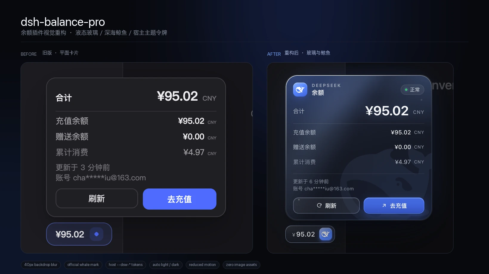

# 视觉设计：深海液态玻璃

> 这是一份设计说明，不是安装文档。安装、配置与数据契约见 [README](../README.md)。



Apple 从 macOS 26 / iOS 26 开始把这种材质语言叫作 **Liquid Glass**；你说的 macOS 27 可以理解为同一条路线的延续。这里复刻的是它的材质逻辑——半透明、背景模糊、镜面高光、边缘折射、同心圆角——没有调用任何系统私有 API，所以在 DSH 的 Web 渲染层里也能成立。

---

## 1. 旧版哪里不够好看

| 问题 | 具体表现 | 结果 |
|---|---|---|
| 材质是平的 | 单色不透明底 + 1px 灰边 + 一层阴影 | 像设置面板，不像浮在界面上的玻璃 |
| 品牌缺席 | 徽章右侧是一颗蓝色菱形，卡片里没有 DeepSeek 标识 | 放在任何产品里都成立，也就不属于 DeepSeek |
| 层级偏弱 | 合计 19px，明细 12px，标签和数值字重接近 | 第一眼抓不住「我还剩多少钱」 |
| 空间偏紧 | `min-width:236px`、12px 内边距 | 邮箱和按钮挤在一起，缺少呼吸感 |
| 主题没真正接上 | 读的是 `--dsw-text` / `--dsw-surface`，而 DSH 实际用的是 `--dsw-alias-*` | 大多数时候落到兜底色，宿主的明暗切换只能靠系统偏好猜 |
| 没有「水」的意象 | 纯色背板 | 和 DeepSeek 的鲸鱼、深海气质没有关系 |

---

## 2. 液态玻璃的配方

玻璃不是「加个 `backdrop-filter`」就成立。它需要同时有：**透过去的背景、内部的折射色、被照亮的边缘、以及一点点脏**。卡片按这四层叠：

1. **背板模糊**：`blur(40px) saturate(1.65)`，对齐 DSH 菜单材质的 `blur(40px) saturate(150%)`；徽章用更轻的 `blur(24px)`。
2. **内部海面**：左上角一束冷蓝光、右上角一点天光、右下角压暗，再叠一层深海线性渐变。这样即使浮层下面是纯黑侧边栏，卡片内部也有「水」的层次。
3. **镜面边缘**：1px 渐变描边，用 `mask-composite: exclude` 只留下边缘；左上最亮、右下带一点品牌蓝。再加 `inset 0 1px 0 rgba(255,255,255,.22)` 的顶边高光。
4. **细节**：4–5% 的细噪点（内联 `feTurbulence`）和两条极淡的水泡，避免大面积渐变出现「塑料感」。

核心 CSS 大致是：

```css
.dsb-panel {
  background: var(--dsb-panel-fill);
  backdrop-filter: blur(40px) saturate(1.65);
  border-radius: 24px;
  box-shadow:
    0 30px 70px -18px rgba(0,0,0,.72),
    0 0 64px -26px rgba(86,134,254,.55),
    0 1px 0 rgba(255,255,255,.22) inset,
    0 -22px 40px -28px rgba(0,0,0,.55) inset;
}
```

描边单独用 `::before`，这样边框可以带方向性，而不是一圈均匀的灰线：

```css
.dsb-panel::before {
  content: "";
  position: absolute;
  inset: 0;
  padding: 1px;
  border-radius: inherit;
  background: linear-gradient(146deg,
    rgba(255,255,255,.72), rgba(255,255,255,.22) 20%,
    transparent 45%, rgba(122,170,255,.36));
  -webkit-mask: linear-gradient(#000 0 0) content-box, linear-gradient(#000 0 0);
  mask-composite: exclude;
  pointer-events: none;
}
```

浅色主题不是把深色反过来：底色改成冷白（`rgba(242,247,255,.68)`），描边换成更实的白 + 一点蓝，阴影从「黑」换成「蓝灰」，否则白底上的卡片会糊成一片。

---

## 3. 鲸鱼怎么放

鲸鱼路径直接取自 DSH 官方品牌字标 `BrandWordmark.tsx` 里的那条鲸鱼（`ui-primitives/src/BrandWordmark.tsx`），不是自己画的近似形，也不是 emoji。它出现在三个尺度：

- **卡片左上角 29px 徽标**：品牌锚点，用品牌蓝渐变底 + 白色鲸鱼。
- **徽章右侧 26px 圆角方块**：一眼识别「这是 DeepSeek 的余额」，同时替代了原来那颗通用菱形。
- **卡片右下角 228px 水下剪影**：8.5% 不透明度，旋转 -7°，被卡片圆角裁掉一部分。它是「背景」，不是第二个 logo。

为什么右上角不放鲸鱼？右上角已经有**状态胶囊**（正常 / 偏低 / 缓存 / 异常），这是更有用的信息。把鲸鱼放在左上、徽章和右下剪影，三个位置各司其职，不会变成三只鲸鱼打架。

> 如果你更喜欢「角落小鲸鱼」而不是「水下大剪影」，把 `.dsb-whale` 的 `width/height` 改成 `110px`，`right/bottom` 收到 `10px`，再把颜色提到 `rgba(146,186,255,.18)` 即可；它就会变成右下角的一枚清晰水印。

---

## 4. 为什么没用照片背景

「加一张 DeepSeek 鲸鱼照片」听起来很直接，但对这个尺寸的浮层来说，照片有三个问题：

1. **可读性**：300px 宽的卡片里要放 27px 金额 + 三行明细，照片的明暗会直接和数字打架，必须再加一层很重的遮罩，最后照片也看不清。
2. **离线与体积**：插件是本地只读的，不应该为了背景去请求外部图片；打包一张 2x 海景图又会把包体从几十 KB 推到几百 KB。
3. **主题**：深色和浅色需要两张图，2x/3x 还要更多；而渐变 + SVG 一套就能同时适配明暗和任意 DPI。

所以这里用的是**内联 SVG 鲸鱼 + CSS 深海渐变 + 光柱 + 水泡**。它不依赖网络、不增加图片请求、在视网膜屏上永远清晰，也不会挡住数字。

如果之后确实想要「用户自己的背景图」，建议加一个 `backgroundImage` 配置，并且：

- 只接受 `https:` / `data:image/`；
- 图片上永远盖一层 45–60% 的深色/浅色 scrim；
- 关闭 `backdrop-filter` 的降级路径下隐藏图片，回到实色。

---

## 5. 版式与层级

| 元素 | 规格 |
|---|---|
| 浮层宽度 | 300px（旧版 236px） |
| 浮层圆角 | 24px；徽章 13px，按钮 11px |
| 内边距 | 15px / 15px / 13px |
| 合计 | 27px，650 字重，`-0.035em` 字距，蓝色微光 |
| 明细 | 12px / 500 字重；标签 11.5px，次级灰 |
| 币种 | 9px（合计处 10px），字距 `.045em`，不与数字抢视线 |
| 头部 | `DEEPSEEK` 9px 大写字距 + `余额` 12.5px |
| 状态 | 10px 胶囊，带呼吸圆点 |
| 操作 | 33px 高，11.5px 字号；充值按钮带品牌蓝渐变和内高光 |

旧版的「合计」和明细几乎一样重；新版把合计放大到 27px，同时把「累计消费」降为次级色，读者的眼睛会先看到余额，再决定要不要看明细。

---

## 6. 状态与动效

- **打开**：340ms，`cubic-bezier(.16,1,.3,1)`，从 `scale(.94) translateY(10px)` 弹到原位；关闭 200ms 缩回。
- **扫光**：打开时一道 1.05s 的斜向高光扫过整张卡片，像玻璃转了个角度。只播一次，不循环。
- **呼吸点**：正常状态的状态点 3.2s 缓慢呼吸；偏低/缓存/异常时停止，避免「看起来还活着」。
- **悬停**：徽章边框转向品牌蓝、鲸鱼方块轻微上浮；卡片本身不跟着鼠标动，余额是读数，不是玩具。
- **降级**：`prefers-reduced-motion` 下关掉扫光、弹入和呼吸；`prefers-reduced-transparency` 下关掉模糊换实色；`prefers-contrast: more` 下加粗描边和文字；不支持 `backdrop-filter` 时用 `@supports not` 退回实色。

状态不只靠颜色：右上角永远有文字（正常 / 偏低 / 缓存 / 异常 / 读取中），红点只是辅助。

---

## 7. 真正接上 DSH 的主题

DSH 桌面端把主题令牌定义在 `body` 上，实际名字是：

- `--dsw-alias-label-primary / -secondary / -tertiary / -caption`
- `--dsw-alias-bg-layer-2`、`--dsw-alias-border-l2/l3`
- `--dsw-alias-link`、`--dsw-static-deepseek-400/450/500`
- 深色由 `body[data-ds-dark-theme]` 标记

旧版读的是 `--dsw-text` / `--dsw-surface`；在本次实测的 0.2.2-rc.1 桌面端里，这些名字并不存在，所以一直在用兜底色。新版改成 `--dsw-alias-*`，并且不再只看 `prefers-color-scheme`：

```js
// 页面背景才是诚实信号；宿主可以强制明暗，和系统设置不一致。
const tone = detectTone() // 'dark' | 'light'
host.setAttribute('data-tone', tone)
```

`detectTone()` 先看 `body[data-ds-dark-theme]`，再看 `body` / `html` 的计算背景亮度，最后才回退到 `prefers-color-scheme`。主题切换时由 `MutationObserver` 同步，不需要刷新页面。

---

## 8. 还能往哪里走

- **可选背景图**：给高级用户一个 `backgroundImage` + `scrim` 配置，而不是默认塞照片。
- **极简模式**：去掉鲸鱼剪影和光柱，只保留玻璃与描边，给喜欢「安静」的人。
- **本地用量账本**：如果以后接入逐轮消耗，可以在合计下面加一条 7 天 sparkline；但不要做数字滚动动画，余额不是老虎机。
- **声音/触觉**：不要。这是一个需要被信任的财务读数。

---

## 9. 实现位置

- 样式与 DOM：`client.js` 里的 `STYLE_TEXT` 和 `mount()`。
- 鲸鱼路径：`client.js` 顶部的 `WHALE_PATH`。
- 主题检测：`client.js` 的 `detectTone()`。
- 没有新增网络请求、没有图片文件、没有第三方依赖。
